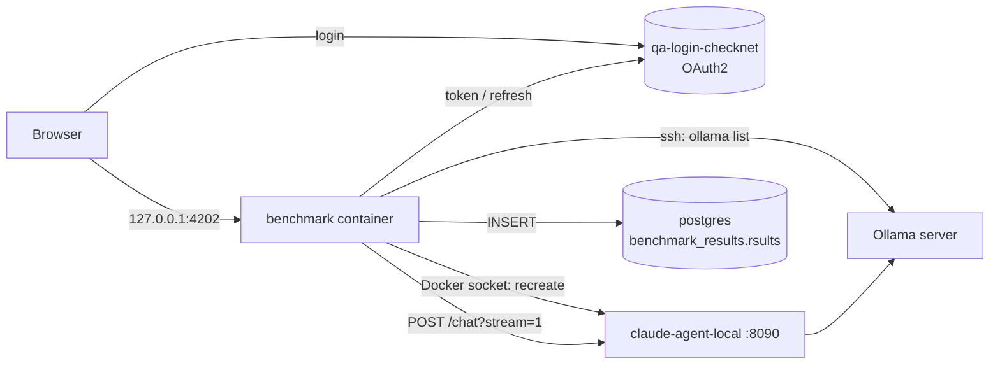

# benchmarking-local-models

A small web app for benchmarking local Ollama models through the
cnu-claude-agent `/chat` endpoint. It replaces the
"Agent benchmark" n8n workflow.

You sign in once with your CheckNet account, upload a JSON Lines file of
questions, pick a model from the Ollama server and start the run. The app
switches the claude-agent container to that model, replays every
conversation, and writes one row per answer to Postgres. A live page shows
the request in flight, the last result and per-session totals.

## How it works



1. **Login.** OAuth2 Authorization Code with PKCE against
   `<login-host>`, client `<client-id>`. It uses the same
   settings as the Postman collection. The refresh token is kept in
   `data/.tokens.json`, so a restart doesn't need a new login. The access token is
   refreshed shortly before it expires, and once more if the agent answers 401.
2. **Model list.** The app runs `ollama list` on the Ollama server over SSH,
   with username and password.
3. **Model switch.** The agent reads `CLAUDE_CHAT_MODEL` only once, at startup
   (`chat.mjs` in cnu-claude-agent). So the app recreates `claude-agent-local`
   through the Docker Engine API. It copies the container's current config and
   only replaces `CLAUDE_CHAT_MODEL` and `ANTHROPIC_BASE_URL`. Then it waits for
   `/health`. If the container already runs that model, nothing happens.
4. **Run.** Questions are grouped by `session`. Conversations run one at a time,
   and messages within a conversation run in file order. Each follow-up continues
   the agent session that the previous answer returned. Every POST may take up to
   **10 minutes**, and the agent is told the same through
   `x-assistant-deadline-seconds: 600`.
5. **Results.** The SSE stream is reduced to one row per answer, using the same
   logic as the n8n "Build result" node. Each row is inserted into
   `benchmark_results.rsults` with the model name.

## Requirements

- Docker Desktop. The app runs in a container.
- These containers on the same machine:
  - `claude-agent-local`, built from cnu-claude-agent and publishing port 8090
  - `postgres`, on the Docker network `local-model-benchmark_default`
- SSH access with username and password to the Ollama server.
- A CheckNet account that can sign in to the QA login server.

## Setup

1. Create your config from the example and fill in the empty values:
   ```bash
   cp .env.example .env
   ```
2. Build and start:
   ```bash
   docker compose up -d --build
   ```
3. Open http://127.0.0.1:4202 and click **Log in**.

`.env` and `data/` are git-ignored. Never commit them.

### Configuration (`.env`)

| Variable | Purpose | Default in example |
|---|---|---|
| `OAUTH_AUTH_URL` / `OAUTH_TOKEN_URL` | Login server endpoints | `…/connect/authorize`, `…/connect/token` |
| `OAUTH_CLIENT_ID` | Public OAuth client (no secret) | `<client-id>` |
| `OAUTH_SCOPE` | Requested scopes, incl. `offline_access` for the refresh token | see file |
| `OAUTH_REDIRECT_URI` | Must match the registered redirect URI | `http://127.0.0.1:4202` |
| `AGENT_BASE_URL` | Where the app reaches the agent | `http://host.docker.internal:8090` |
| `AGENT_CONTAINER` | Agent container to recreate | `claude-agent-local` |
| `AGENT_OLLAMA_URL` | Written to the agent's `ANTHROPIC_BASE_URL`; leave empty to keep the current value | `http://<ollama-host>:11434` |
| `AGENT_ENV` | `env` sent in each `/chat` body | `qa` |
| `OLLAMA_SSH_HOST` / `OLLAMA_SSH_PORT` | Ollama server SSH address | `<ollama-host>` / `22` |
| `OLLAMA_SSH_USER` / `OLLAMA_SSH_PASSWORD` | Your SSH login | *(fill in)* |
| `OLLAMA_SSH_HOSTKEY_SHA256` | Optional host key pin (`SHA256:…`); when set, the app refuses any other server | *(empty)* |
| `PG_NETWORK` | Docker network the app joins to reach Postgres | `local-model-benchmark_default` |
| `PGHOST` `PGPORT` `PGDATABASE` `PGUSER` `PGPASSWORD` | Postgres connection | `postgres`, `5432`, `n8n`, `n8n`, *(fill in)* |

## Input file

JSON Lines: one JSON object per line. Blank lines are skipped.

```json
{"session": "05ef829c-…", "question": "are you able to check what happened to this poctrlno? 417749805", "answer": "This PoCtrlNo … REPLACED …"}
{"session": "05ef829c-…", "question": "and which vendor is it?", "answer": "vendor 0000544"}
{"question": "a standalone question"}
```

| Field | Required | Meaning |
|---|---|---|
| `question` | yes | Message sent to the agent |
| `answer` | no | Expected answer, stored as `expected_answer` for comparison |
| `session` | no | Lines with the same value form one conversation. Without it, the line is its own conversation |

Extra fields (such as `askedAt`) are ignored. Unlike the n8n flow, sessions with
fewer than 3 messages are not skipped.

## Progress page

While a run is going, the page refreshes every 2 seconds and shows:

- **Progress**: state, model, answered/total and failures.
- **Current request**: session, message number, the agent session being
  continued, the question, and how long it has been waiting.
- **Last result**: ok/failed, latency, turns, tool calls, cost, reply, expected
  answer and error.
- **Sessions**: every session, with answered/ok/failed, average latency, tool
  calls and cost. Expand a session to see its messages, and expand a message to
  see its reply and expected answer.

Only one run can be active at a time. Progress is kept in memory, so restarting
the container clears the page. The rows already written to Postgres stay.

## Results

Rows go to `benchmark_results.rsults`. On startup the app adds a `model`
column if it doesn't exist yet. Example query:

```sql
SELECT model, run_id, "sessionId", ok, latency_ms, turns, "toolCalls", prompt, reply, expected_answer
FROM benchmark_results.rsults
ORDER BY run_id DESC;
```

- `run_id` is the run's start time in Unix seconds, shared by every row of one run.
- `ok` is `true` when the agent returned a result and no error.

## Development

```bash
npm install
npm test
```

`npm test` runs the unit tests with Node's test runner and writes coverage to
`lcov.info` for SonarQube.

| File | Role |
|---|---|
| `server.mjs` | HTTP server: page, OAuth callback, `/login`, `/api/status`, `/api/models`, `/api/run` |
| `oauth.mjs` | PKCE login, token exchange and refresh, token file |
| `ollama.mjs` | `ollama list` over SSH |
| `docker.mjs` | Minimal Docker Engine API client over the socket |
| `agent.mjs` | Model switch, `/chat` POST with 10-minute timeout, SSE parsing |
| `benchmark.mjs` | JSONL parsing, session grouping, run loop and progress state |
| `db.mjs` | Postgres schema check and inserts |
| `public/index.html` | The single page |

### SonarQube

A local SonarQube runs on port 9000. Create a token there (My Account →
Security), store it in the `SONAR_TOKEN` environment variable, then scan:

```bash
docker run --rm -e SONAR_HOST_URL=http://host.docker.internal:9000 -e SONAR_TOKEN -v "$PWD:/usr/src" sonarsource/sonar-scanner-cli
```

Run `npm test` first so the coverage report is current. Settings are in
`sonar-project.properties`.

## Security notes

- The app mounts `/var/run/docker.sock`, which gives it full control over Docker
  on the host. That's why the page is only bound to `127.0.0.1`.
- Tokens and passwords never appear in logs or in the browser. The refresh token
  is stored in `data/.tokens.json` with mode 0600.

## Troubleshooting

| Symptom | Likely cause |
|---|---|
| "Could not load models" | Wrong SSH user/password, or the server isn't reachable on port 22 |
| Run stops at "starting agent" | Docker socket not mounted, Enhanced Container Isolation blocks it, or the agent didn't pass `/health` within 60 s |
| Every answer fails with `HTTP 401` | Refresh token expired or revoked. Log in again |
| `could not prepare the results table` in the logs | Wrong Postgres credentials, or the app isn't on `PG_NETWORK` |
| "line N: not valid JSON" | That line of the input file isn't a single complete JSON object |
