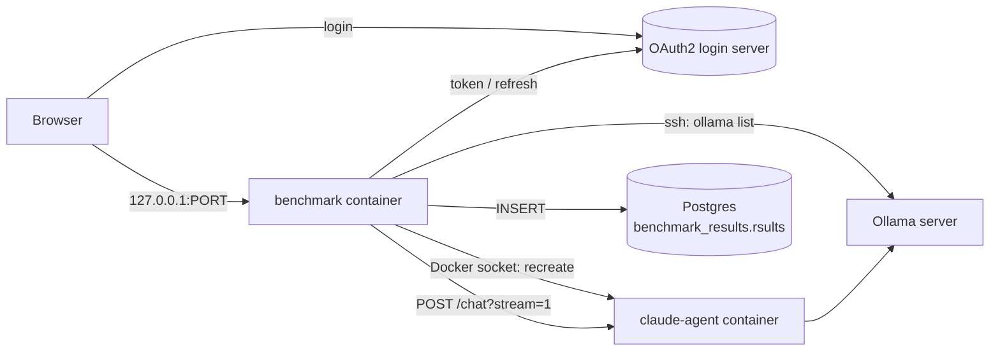

# benchmarking-local-models

A small web app for benchmarking local Ollama models through the
cnu-claude-agent `/chat` endpoint. It replaces the
"Agent benchmark" n8n workflow.

You sign in once with your CheckNet account, upload a JSON Lines file of
questions, pick a model from the Ollama server and start the run. The app
switches the claude-agent container to that model, replays every
conversation, and writes one row per answer to Postgres. A live page shows
the request in flight, the last result and per-session totals.

## How it works



1. **Login.** OAuth2 Authorization Code with PKCE against the login server and
   client set in `.env`. The refresh token is kept in
   `data/.tokens.json`, so a restart doesn't need a new login. The access token is
   refreshed shortly before it expires, and once more if the agent answers 401.
2. **Model list.** The app runs `ollama list` on the Ollama server over SSH,
   with username and password.
3. **Model switch.** The agent reads `CLAUDE_CHAT_MODEL` only once, at startup
   (`chat.mjs` in cnu-claude-agent). So the app recreates the agent container
   through the Docker Engine API. It copies the container's current config and
   only replaces `CLAUDE_CHAT_MODEL`, `ANTHROPIC_BASE_URL` and
   `CLAUDE_CODE_MAX_OUTPUT_TOKENS` (42000 unless `AGENT_MAX_OUTPUT_TOKENS` says
   otherwise; the agent passes its environment on to Claude Code). When
   `AGENT_REPO_MIRROR` is set it also mounts that mirror read-only at
   `/srv/repos` (see [Repo mirror](#repo-mirror)). Then it waits for
   `/health`. If the container already runs that model with that mount and limit, nothing happens.
4. **Run.** Questions are grouped by `session`. Conversations run one at a time,
   and messages within a conversation run in file order. Each follow-up continues
   the agent session that the previous answer returned. Every POST may take up to
   **10 minutes**, and the agent is told the same through
   `x-assistant-deadline-seconds: 600`.
   Labelizer generation calls (`Target LabelId:` prompts) go to `/from-pdf`
   instead, as in QA. The app waits for the job's real result
   (`GENERATE_TIMEOUT_S`, default 21600 s = 6 h): the agent keeps a job running
   after its caller leaves, so giving up earlier only stacks the next job on top.
   See [Messages that had a file](#messages-that-had-a-file).
5. **Results.** The SSE stream is reduced to one row per answer, using the same
   logic as the n8n "Build result" node. Each row is inserted into
   `benchmark_results.rsults` with the model name.

## Requirements

- Docker Desktop. The app runs in a container.
- These containers on the same machine:
  - the claude-agent container, built from cnu-claude-agent, with its port published
  - Postgres, on a Docker network the app can join
- SSH access with username and password to the Ollama server.
- A CheckNet account that can sign in to the QA login server.

## Setup

1. Create your config from the example and replace every `<placeholder>`.
   All hosts, URLs and ports live only in `.env`; the app refuses to start when
   one is missing.
   ```bash
   cp .env.example .env
   ```
2. Build and start:
   ```bash
   docker compose up -d --build
   ```
3. Open `http://127.0.0.1:<PORT>` and click **Log in**.

`.env` and `data/` are git-ignored. Never commit them.

### Repo mirror

The agent answers plugin-logic, FDS and Layout Designer questions from a repo
mirror at `/srv/repos`. In the swarm that is an NFS share filled by the
`claude-mirror-sync` service. Locally you fill a Docker volume once with the
same script, from the agent image. It needs a read-only GitHub token for the
`checkpt-als` org and an Azure DevOps PAT with Code (Read). Without a mirror,
those questions can't be answered, which skews the benchmark.

```bash
docker volume create claude-repos
```

The image runs as `node`, and a new volume is owned by root, so hand it over once:

```bash
docker run --rm --user root -v claude-repos:/srv/repos --entrypoint chown cnu-claude-agent-benchmark:latest node:node /srv/repos
```

Then set `GH_TOKEN` and `AZDO_PAT` in your shell (don't put them in `.env`), and run:

```bash
docker run --rm -e GH_TOKEN -e AZDO_PAT -e CNU_REPO_MIRROR=/srv/repos -v claude-repos:/srv/repos --entrypoint node cnu-claude-agent-benchmark:latest /app/sync-mirror.mjs --once
```

Set `AGENT_REPO_MIRROR=claude-repos` in `.env` and restart the app. The next run
recreates the agent with the mirror mounted. Run the sync again to refresh it;
`/srv/repos/.synced` holds the date of the last clean sync.

**The mirror and its tokens are optional.** At the start of each run the app
checks which half of the mirror the agent has: `github/` (filled with
`GH_TOKEN`) and `devops/` (filled with `AZDO_PAT`). If `github/` is missing, or
`AGENT_REPO_MIRROR` is empty, every message that needs the mirror is **skipped**
with the reason, for example *needs the repo mirror, which is not synced:
GH_TOKEN and AZDO_PAT missing*. The rest of the run goes ahead, and a
conversation carries on past its skipped messages. Once you've synced the
mirror, run the same file again to answer the skipped questions.

`github/` holds the new-flow plugins, the CNU services and the Layout Designer
manual, so a mirror without `devops/` is still used: those messages are asked,
and the page notes that the agent can't read the legacy
`CKP.RI.RetailerPlugIn.*` code.

**A local mirror of clones** works too. Shallow-clone the repos you need into
`<folder>/github/checkpt-als/<repo>` (and `<folder>/devops/checknet-onboarding/<repo>`
for legacy plugins), then set `AGENT_REPO_MIRROR` to the folder in Docker
Desktop's Linux form, for example
`/run/desktop/mnt/host/c/Users/<you>/Documents/Repositories/cnu-repo-mirror`.
Not `C:\…`: the colon after the drive letter breaks the mount. On Windows, clone
with `-c core.longpaths=true`, or cnu-backoffice-frontend and cnu-labelizer-engine
only check out partly.

### Agent image

The app recreates the agent from `cnu-claude-agent-benchmark:latest`. Build it
from the cnu-claude-agent checkout next to this repo, with the `.env` values for
`AGENT_ENV`, `AGENT_OLLAMA_URL` and `AGENT_MAX_OUTPUT_TOKENS` as defaults
([agent/Dockerfile](agent/Dockerfile)). `AGENT_WRAP_UP_SECONDS` (default 120)
becomes the agent's `CHAT_WRAP_UP_SECONDS`: that long before the deadline, plus
10 s, the agent refuses further tool calls and the model writes its answer.
With the 600 s budget it stops looking at 470 s.

```bash
docker compose --profile agent build agent
```

### Configuration (`.env`)

| Variable | Purpose |
|---|---|
| `PORT` | Port the app listens on and is published on (`127.0.0.1` only) |
| `OAUTH_AUTH_URL` / `OAUTH_TOKEN_URL` | Login server authorize and token endpoints |
| `OAUTH_CLIENT_ID` | Public OAuth client (no secret) |
| `OAUTH_SCOPE` | Requested scopes, incl. `offline_access` for the refresh token |
| `OAUTH_REDIRECT_URI` | Registered redirect URI; its port must equal `PORT` |
| `AGENT_BASE_URL` | Where the app reaches the agent (from inside its container) |
| `AGENT_CONTAINER` | Agent container to recreate |
| `AGENT_OLLAMA_URL` | Written to the agent's `ANTHROPIC_BASE_URL`; leave empty to keep the current value |
| `AGENT_ENV` | `env` sent in each `/chat` body |
| `AGENT_MAX_OUTPUT_TOKENS` | Written to the agent's `CLAUDE_CODE_MAX_OUTPUT_TOKENS`. Default `42000` (Claude Code's own default is 32000) |
| `GENERATE_TIMEOUT_S` | Seconds the app waits for a labelizer generation call to `/from-pdf`. Default `21600` (6 h). A local model can need about an hour per template, and the agent keeps working after the app stops waiting |
| `AGENT_REPO_MIRROR` | Docker volume or host path with the repo mirror, mounted read-only at `/srv/repos` in the agent. Empty: no mirror |
| `OLLAMA_SSH_HOST` / `OLLAMA_SSH_PORT` | Ollama server SSH address |
| `OLLAMA_SSH_USER` / `OLLAMA_SSH_PASSWORD` | Your SSH login |
| `OLLAMA_SSH_HOSTKEY_SHA256` | Optional host key pin (`SHA256:…`); when set, the app refuses any other server |
| `QA_SESSIONS_SSH_HOST` / `QA_SESSIONS_SSH_PORT` / `QA_SESSIONS_SSH_USER` | The QA host with the agent's session transcripts (not the Ollama server). Empty: messages that had a file are skipped |
| `QA_SESSIONS_SSH_KEY_PATH` | Host path of your private key for that host. Compose mounts it read-only and sets `QA_SESSIONS_SSH_KEY_FILE` |
| `QA_SESSIONS_SSH_KEY_PASSPHRASE` | Only if the key has one |
| `QA_SESSIONS_SSH_HOSTKEY_SHA256` | Optional host key pin for the QA host |
| `RI_PGHOST` `RI_PGPORT` `RI_PGDATABASE` `RI_PGUSER` `RI_PGPASSWORD` `RI_PGSSLMODE` | RetailerIntegration Postgres (read-only user), for the label history in `/benchmark-report`. Used from your PC, not the container |
| `PG_NETWORK` | Docker network the app joins to reach Postgres |
| `PGHOST` `PGPORT` `PGDATABASE` `PGUSER` `PGPASSWORD` | Postgres connection |

## Input file

JSON Lines: one JSON object per line. Blank lines are skipped.

```json
{"session": "05ef829c-…", "question": "are you able to check what happened to this poctrlno? 417749805", "answer": "This PoCtrlNo … REPLACED …"}
{"session": "05ef829c-…", "question": "and which vendor is it?", "answer": "vendor 0000544"}
{"question": "a standalone question"}
```

| Field | Required | Meaning |
|---|---|---|
| `question` | yes | Message sent to the agent |
| `answer` | no | Expected answer, stored as `expected_answer` for comparison |
| `session` | no | Lines with the same value form one conversation. Without it, the line is its own conversation |
| `needs` | no | What answering needs, as a list. `["mirror"]`: the repo mirror (plugin code, FDS, Layout Designer manual). `[]`: nothing extra. Without the field a keyword check guesses, and it misses most cases |

`hanuman-qa-2026-10-29.tagged.jsonl` is the 10-29 file with `needs` filled in
from the run 1793258147 report: 73 of its 232 questions need the mirror.

Extra fields (such as `askedAt`) are ignored. Unlike the n8n flow, sessions with
fewer than 3 messages are not skipped.

### Messages that had a file

The QA export keeps only the text of a message. A message that had a file still
shows it: the agent's note "The person attached N file(s) to this message…", or
a labelizer generation prompt's `INPUT PDF:`. For those messages only, the app
fetches that QA session's transcript over SSH. This is the Node version of
`get-session.sh`: `sudo /usr/local/bin/claude-session get <session>` on the QA
host. The app then sends the file along with the replay:

- A named file is recovered when the agent read it in QA and got it back whole.
  That covers PDFs and images. Screenshots sent with the message come along too.
- CSV, XML and spreadsheets come back as text or not at all. Those messages are
  skipped, and the reason is shown, as is a message whose session can't be
  fetched or whose files exceed the agent's limits (5 files, 5 MB per image,
  10 MB per document, 20 MB in total).
- The old note is removed from the question, because the agent writes its own.
  The saved `prompt` stays the input line.
- A labelizer generation prompt is not sent to `/chat`: its recovered PDF goes
  to the agent's `POST /from-pdf` with the `Target LabelId` and `Target RetailerId`,
  as QA did. The saved reply is a short summary: `result.json` (label size, dpi,
  object count, caveats) and the template's objects by type. These rows have no
  agent session. Without a PDF the message is skipped.

Transcripts contain customer data. They're held in memory for the run only. The
results table keeps just the file metadata (`attachments`: name, type, size,
sha256).

## New benchmark page (`/new`)

You start a benchmark here:

1. **Log in** with your CheckNet account. The agent calls the Back Office with it.
2. **Choose the questions file.** It's checked and shown as sessions with their
   messages. Everything is selected at first.
3. **Choose what to ask.**
   - Tick or untick whole sessions or single messages. Expand a session to read its
     messages, and a message to read the full question and the expected answer.
   - Badges help you choose: `file: <name>` (the file is fetched from the QA
     session), `labelizer generation`, `label <id>` and `needs mirror`.
   - The filter hides messages that don't contain its text. With a filter, *Select
     shown* and *Clear shown* change only the messages it shows.
   - A ticked message whose earlier turns are unticked gets a note: it's asked
     without those turns, so the agent lacks their context.
4. **Choose the model** and **start**. Only the ticked messages are asked, in file
   order and per session, and each saved row keeps its line in the file
   (`input_line`). The page then switches to the progress page.

`POST /api/run` without `lines` still asks every line.

## Progress page

`/` shows the running benchmark, or a link to `/new` when none is running. If your
login expires during a run, it opens the login again. While a run is going, the page
refreshes every 2 seconds and shows:

- **Progress**: state, model, answered/total, failures, token-limit answers and
  skipped messages. A grey line says when the repo mirror is missing and which
  tokens it needs.
  The red line under the bar only appears when the whole run stopped (for
  example the agent didn't become healthy). Errors of single answers stay on
  their message.
- **Current request**: session, message number, the agent session being
  continued, the question, and how long it has been waiting.
- **Last result**: ok / failed / token limit, latency, turns, tool calls, cost, reply, expected
  answer and error.
- **Sessions**: every session, with answered/ok/failed, average latency, tool
  calls and cost. Expand a session to see its messages, and expand a message to
  see its reply and expected answer.

A message whose answer passed Claude Code's output token maximum
(`CLAUDE_CODE_MAX_OUTPUT_TOKENS`, 42000 here) gets the status **⚠ token limit**
instead of failed. The run carries on with the next message, in a **fresh agent
session**: a resumed session almost always hits the limit again.

So that the follow-up keeps its context, its message starts with a **recap**:
every earlier question of the conversation with the agent's answer, each answer
cut at 800 characters ("(no answer)" for one that failed), then the new
question. The same happens when a conversation's first answer failed without a
session. Only that first message of the new session gets the recap; later ones
continue the new session. The message is marked **↻ recap**, its row has
`context_recap = true` and a new `sessionId`, and `prompt` keeps the original
question. A recap is shorter than the real history, so judge these answers with
that in mind.

Only one run can be active at a time. Progress is kept in memory, so restarting
the container clears the page. The rows already written to Postgres stay.

## Results page

`http://127.0.0.1:<PORT>/results` shows every stored run, newest first. You can
filter by:

- **Model**: the models found in the table.
- **From / To**: calendar days in your local time, both inclusive.
- **Min / max messages per session**: only sessions with that many messages in
  their run.

Each run shows its date, model, sessions, messages, ok % (of the messages that
were asked), token-limit count, skipped count, recapped count,
average latency, tool calls and cost. Expand a run to see its sessions, and a
session to see each question with reply, expected answer and error.

## Results

Rows go to `benchmark_results.rsults`. On startup the app adds the `model`,
`created_at` (insert time), `token_limit`, `skip_reason` and `context_recap` columns if they
don't exist yet.

The one-off migration `migrations/2026-10-30-created-at.sql` adds the same
columns and backfills the rows from before them. Run it once:

```bash
docker exec -i postgres psql -U n8n -d n8n -v ON_ERROR_STOP=1 < migrations/2026-10-30-created-at.sql
```

Example query:

```sql
SELECT model, run_id, created_at, "sessionId", ok, token_limit, latency_ms, turns, "toolCalls", prompt, reply, expected_answer
FROM benchmark_results.rsults
ORDER BY run_id DESC;
```

- `run_id` is the run's start time in Unix seconds, shared by every row of one run.
- `ok` is `true` when the agent returned a result and no error.
- `token_limit` is `true` when the answer passed the output token maximum.
- `context_recap` is `true` when the message was asked in a fresh session with
  the earlier turns recapped (see [Progress page](#progress-page)).
- `skip_reason` is empty for asked messages. For a skipped one it says why, and
  `ok` is `false` with an empty reply.

## Reports

In Claude Code, opened in this repository, run:

```text
/benchmark-report [run_id] [input.jsonl]
/benchmark-report today
/benchmark-report 2026-10-28 2026-11-02
```

Besides the scores, the report gives advice:
- **How Hanuman answers each role**: per persona, what to change in how it answers,
  phrased for the system prompt or a skill.
- **Irrelevant questions**: whether Hanuman stops at questions outside its scope and
  tells the asker so.
- **Labelizer vs RetailerIntegration**: for every message that names a label id (a
  labelizer generation call's `Target LabelId: <n>`, or "label id 103" in a question),
  `scripts/label-ri.mjs` reads the label's history from RetailerIntegration's
  `ri.labelizer_generation_feedback`. The report then compares the questions with the
  corrections: how many per question, and how long after the question and after the
  generation. The judges also check the reply against that history.

The label lookup needs the `RI_PG*` settings in `.env`. Without them, the report leaves
the comparison out and says so. `CreatedBy` is user data, so keep the report local.

Without arguments it takes the most recent run and finds the matching input file
in `Benchmark tests local models`. It writes `reports/run-<run_id>.md`. `today`
covers every run that ended today, and a date range every run that ended in it
(both days included); those write one combined report, `reports/runs-<from>_<to>.md`,
with a per-run breakdown. A run that is still going is left out. In that
report every answer is categorized by question type and persona and scored 0–3
against the production reference. The scores are weighted by question type,
persona and what the agent could access. `reports/run-1793258147.md` is an
example.

The skill is in `.claude/skills/benchmark-report/`:
- `SKILL.md`: the steps.
- `rubric.md`: the judging rubric.
- `scripts/export-run.mjs`: exports a run, or the runs in a date window, from Postgres.
- `scripts/aggregate.mjs`: weights and tables.
- `scripts/label-ri.mjs`: label history from RetailerIntegration, before judging.
- `scripts/match.mjs`: matches a run of chosen messages to its input file by line.

Working files go to `reports/work/`, which is git-ignored. The appendix of a
report contains customer names and order numbers from real sessions.

## Development

```bash
npm install
npm test
```

`npm test` runs the unit tests with Node's test runner and writes coverage to
`lcov.info` for SonarQube.

| File | Role |
|---|---|
| `server.mjs` | HTTP server: page, OAuth callback, `/login`, `/api/status`, `/api/models`, `/api/run` |
| `oauth.mjs` | PKCE login, token exchange and refresh, token file |
| `ollama.mjs` | `ollama list` over SSH |
| `docker.mjs` | Minimal Docker Engine API client over the socket |
| `agent.mjs` | Model switch, `/chat` POST with 10-minute timeout, SSE parsing |
| `benchmark.mjs` | JSONL parsing, session grouping, run loop and progress state |
| `results.mjs` | Results page filters and grouping into runs and sessions |
| `db.mjs` | Postgres schema check, inserts and the results query |
| `public/index.html` | Benchmark page |
| `public/results.html` | Results page |
| `public/common.js`, `public/style.css` | Helpers and styles shared by both pages |
| `migrations/` | One-off SQL scripts, run by hand |

### SonarQube

Create a token in your SonarQube (My Account → Security) and store it in the
`SONAR_TOKEN` environment variable. Set `SONAR_HOST_URL` to the SonarQube URL as
seen from a container, then scan:

```bash
docker run --rm -e SONAR_HOST_URL -e SONAR_TOKEN -v "$PWD:/usr/src" sonarsource/sonar-scanner-cli
```

Run `npm test` first so the coverage report is current. Settings are in
`sonar-project.properties`.

## Security notes

- The app mounts `/var/run/docker.sock`, which gives it full control over Docker
  on the host. That's why the page is only bound to `127.0.0.1`.
- Tokens and passwords never appear in logs or in the browser. The refresh token
  is stored in `data/.tokens.json` with mode 0600.

## Troubleshooting

| Symptom | Likely cause |
|---|---|
| "Could not load models" | Wrong SSH user/password, or the server isn't reachable on `OLLAMA_SSH_PORT` |
| Skipped: `qa-session: could not fetch …` | Wrong QA key, user or host pin, the key isn't mounted, or the user may not `sudo claude-session` |
| Skipped: `attachment not recoverable …` | The file was a CSV, XML or spreadsheet, or a PDF the agent never read in QA |
| Run stops at "starting agent" | Docker socket not mounted, Enhanced Container Isolation blocks it, or the agent didn't pass `/health` within 60 s |
| Every answer fails with `HTTP 401` | Refresh token expired or revoked. Log in again |
| `could not prepare the results table` in the logs | Wrong Postgres credentials, or the app isn't on `PG_NETWORK` |
| `missing settings in .env: …` in the logs | Those keys are empty or absent in `.env` |
| "line N: not valid JSON" | That line of the input file isn't a single complete JSON object |
